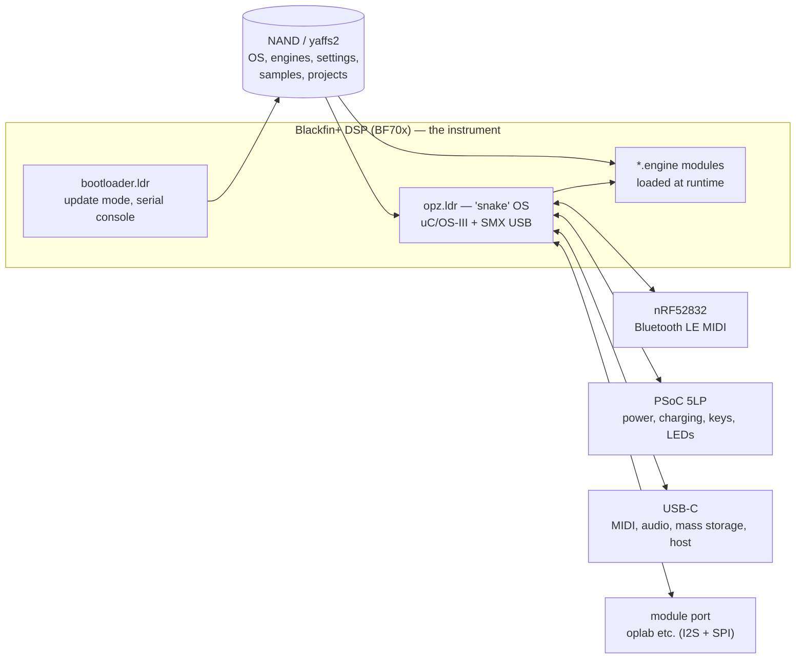
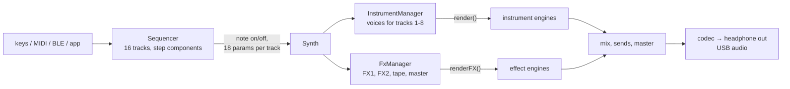

# 01 — System overview

The OP-Z is three computers in one case, plus a NAND file system. Only one of them makes sound.

## The three processors

| Chip | Firmware (1.2.45 package) | Job | Relevance to new sounds |
|---|---|---|---|
| ADI Blackfin+ BF70x | `bootloader.ldr`, `opz.ldr` | Sequencer, synthesis, effects, USB, files | **All of it.** Engines run here, in fixed point. |
| Nordic nRF52832 | `nrf52832_opz.bin` (+ signed `.dat`) | Bluetooth MIDI and the app link | A second transport for the file protocol |
| Cypress PSoC 5LP | `SnakeKeyboardModule_*.cyacd` | Power, USB-PD, charger, key matrix, LEDs | None, except LED feedback |

The Blackfin+ has **no floating-point unit**. Its strengths are 16/32-bit fractional multiply-accumulate,
saturating arithmetic and zero-overhead loops. Every engine is fixed-point code (`fract32`, Q31). [code]

The internal codename for the whole product is **snake** (`C:\snake-software\…`). The OP-Z desktop app's
`SnakePlugin.bundle` is the same C++ code base compiled for macOS, with symbols, and it is the best
reference for how the device's host code behaves. [code]

## Software layers on the Blackfin

| Layer | Contents |
|---|---|
| `src/bf/` platform | NAND and yaffs2, SPI flash, codec, USB control, **`dlm` (the module loader)**, mass storage |
| `src/sequencer/` application | `Sequencer`, `Pattern`, `StepComponentManager`, `Synth`, `Voice`, `InstrumentManager`, `FxManager`, **`PlugManager`**, `MasterEffects`, `Lfo`, `StateSync`, file manager, DMX, lights |
| `src/shared/` | Serial message handling and command handlers shared with the bootloader |
| RTOS | uC/OS-III for the application (`main_task`, `sequencer_task`, `filemanager_task`, `jack_task`); SMX for the USB device and host stacks |
| L1 overlay | Hot code (serial command handler, companion message sender) in on-chip memory |

## Boot modes

| How to enter | Mode | What it is for |
|---|---|---|
| Plain power-on | **Synth (normal) mode** | Playing. USB MIDI and the SysEx file service are live here. |
| Hold TRACK at power-on, or the hidden `restart-into-content` command | **Content mode** ("OP-Z Disk") | Mass storage for samples, projects and config |
| Hold SCREEN at power-on, or `restart-into-bootloader` | **Update mode** ("OP-Z Boot") | Firmware install; exposes a CDC serial console that is a **root shell** |

Engine work happens entirely in **synth mode**. Update mode is only for recovery, and its console can format the
NAND with one byte — see [SAFETY.md](../../SAFETY.md).

## Storage

| Location | Contents |
|---|---|
| SPI flash `0x00000` | First-stage loader |
| SPI flash `0x10000` | Main bootloader (two copies, A/B) |
| `/yaffs2/os.ldr` | The OS image |
| `/yaffs2/user/engines/` | **Engine binaries** (factory and user alike) |
| `/yaffs2/user/settings/` | `plugs.json`, `slotConfiguration.json`, `plugDefinitions.dat`, `plugPresets.dat` |
| `/yaffs2/user/samplepacks/` | Drum packs and synth samples |
| `/yaffs2/user/projects/`, `config/` | Projects, `general.json`, `midi.json`, `dmx.json` |
| `/yaffs2/system/content/` | Factory copies used to seed `user/` |
| `/yaffs2/logs/{system,upgrade,import,battery}` | Logs |

The `.zfw` firmware update is an encrypted wrapper around an ordinary ZIP. The installer's only integrity check is each
ZIP entry's CRC. [code] We do **not** need to build firmware updates to ship engines.

## Signal flow at a glance

Continue with [02 — The sound engine host](02-sound-engine-host.md).
