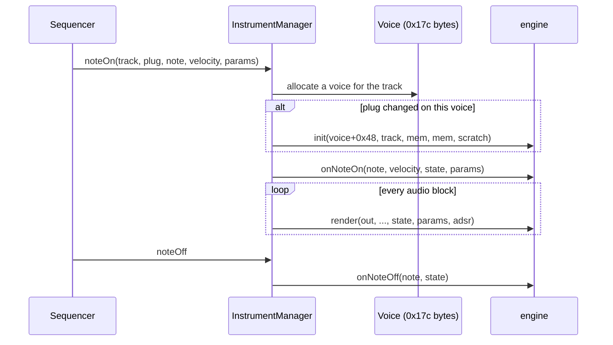

# 02 — The sound engine host

This is how the OS turns a sequenced note into audio, and the contract an engine lives inside. The exact
function signatures are in the [Engine ABI](../../sdk/docs/engine-abi.md).

## Tracks

The OP-Z has 16 tracks. Eight make sound through instrument engines, four are effect processors, and four are
control tracks that never call an engine.

| # | Track | Kind | Default voices | Track-mask bit |
|---|---|---|---|---|
| 1 | kick | instrument (samples) | 2 | `0x0001` |
| 2 | snare | instrument (samples) | 2 | `0x0002` |
| 3 | perc | instrument (samples) | 2 | `0x0004` |
| 4 | sample | instrument (samples) | 2 | `0x0008` |
| 5 | bass | instrument (synth) | 2 | `0x0010` |
| 6 | lead | instrument (synth) | 3 | `0x0020` |
| 7 | arp | instrument (synth) | 2 | `0x0040` |
| 8 | chord | instrument (synth) | 4 (6 with `generous_chords`) | `0x0080` |
| 9 | FX1 | effect | — | `0x0100` |
| 10 | FX2 | effect | — | `0x0200` |
| 11 | tape | effect | — | `0x0400` |
| 12 | master | effect | — | `0x0800` |
| 13–16 | perform, module, lights, motion | control | — | — |

Voice counts come from the app's `voicePolyphony` / `generousVoicePolyphony` tables. [code]

A plug's `trackmask` says which tracks may use it: synth plugs use `0xF0`, drum packs one of `0x1`–`0x8`, the delay
`0x100` (FX1 only), reverbs, distortion and crush `0x300` (FX1 or FX2), tape `0x400`, master chorus `0x800`.

## Instruments: voices and `render`

- Each voice is a `0x17c`-byte record. The engine's per-voice **state starts at `+0x48`, and an engine owns
  ≤ 280 bytes per voice** inside the record: the OS keeps its portamento fields at `+0x160…+0x17b` [code, device;
  the desktop app's layout suggested 308]
- All voices of a track render **into the same buffer** — 64 frames of interleaved stereo — so engines add into it
  (saturating) and write both channels. [code, proven]
- The host owns the **amplitude envelope** object, the **LFO** (`Lfo::render`), pitch bend, vibrato and
  portamento. The engine calls `updateParametersADSR` once per block, applies the envelope per sample, and the
  host frees the voice when the envelope reaches its idle stage. [code]
- `pitch` arrives as a Q32 phase increment at 44.1 kHz — except on drum tracks, where it is a fixed unity rate
  and the key arrives only as the note number in `onNoteOn`. [code, proven]
- On CPU overload the host kills notes (`cpu overload: kill notes %d`, `InstrumentManager::handleOverload`). [code]

## Effects: `renderFX`

- One record per FX track (`0xe0` bytes), engine state from `+0x10`, so **≤ 204 bytes of in-record state**. [code]
- Effects get a **large buffer** for delay lines. Its size is requested by the engine's `initModule` (see below)
  and carved out of a per-track pool starting at `0x8112B21C`. The offset table is identical in the app and on the
  device (`0x8156f21c`) [code]:

  | FX track | Pool offset | Pool size |
  |---|---|---|
  | FX1 | `0x000000` | **2 MB** |
  | FX2 | `0x200000` | **256 KB** |
  | tape | `0x240000` | **2 MB** |
  | master | `0x440000` | **16 KB** (the table follows it) |

  This explains TE's track masks: `delay` asks for 2 MB, so it is FX1-only; `fdnreverb` asks for 239 KB, so it
  fits FX2; the master chorus asks for exactly 16 KB. **A new FX must request ≤ 256 KB to run on FX2 and ≤ 16 KB
  to run on master.** [code, device]
- Instruments get no large buffer of their own (see the ABI's `init`).
- Effects also receive `onNoteOn`/`onNoteOff`, so notes sequenced on an FX track can drive them (tape uses this
  for tape-stop and pitch tricks). [code]
- `renderFX` reads interleaved stereo from an input buffer and writes interleaved stereo to a separate output
  buffer; it also gets the FX track's pitch bend and a gain. TE's `crush` uses the FX track's pan parameter as
  dry/wet and its level parameter as output level. [code, proven on hardware]
- Track sends **crossfade**: turning a track's FX send up moves its signal from the dry path into the FX track, so
  at 100 % the track is heard only through the effect. [proven]

## `initModule` asks for memory

`initModule(version, callbacks, &request)` is called once when an engine loads. Across the 21 official engines it
checks the version argument, stores the callback-table pointer, and writes a **memory-size request** [notes]:

| Engine | Request |
|---|---|
| chorus | 16 KB |
| chorus2 | 32 KB |
| reverb | 114 KB (device) |
| fdnreverb | 239 KB |
| delay, tapetwo | 2 MB |
| most instruments | 0 |

## Parameters

Every audio track has **18 sound parameters**, stored as bytes (0–255). Their order is known from the project
format and matches the parameter-lock order [notes, proven]:

| Index | Parameter | Page | Who uses it |
|---|---|---|---|
| 0 | **P1** (engine-defined, e.g. "tone") | sound | engine |
| 1 | **P2** (engine-defined, e.g. "digital") | sound | engine |
| 2–5 | attack, decay, sustain, release | envelope | host ADSR (engines may read them) |
| 6, 7 | FX1 send, FX2 send | FX | host mixer, taken from what the engine wrote (after its level and pan) [code, app] |
| 8, 9 | filter, resonance | sound | **host track filter**, after the engine [code, proven] |
| 10, 11 | pan, level | FX | **the engine**: every TE instrument applies them in `render`; the OS does not [code, app + device; [engine-abi.md §4](../../sdk/docs/engine-abi.md#level-pan-and-the-sends)] |
| 12 | portamento | — | host |
| 13–16 | LFO depth, speed, target, shape | LFO | host `Lfo` |
| 17 | note style | — | host |

On the way to the engine each byte `b` becomes `b·0x808080 + (b >> 1)` — a Q31 value from 0 to ≈1.0 — and is
smoothed every block with a 1/64 one-pole (`Synth::setTargetParameters` / `interpolateParameters`). [code]

**What this means for engine design:** an engine gets two dedicated knobs (P1, P2) — not the filter and
resonance knobs, which drive the OS's own track filter on instrument and FX tracks [proven]. The envelope stages, LFO and
sends are handled by the OS; **level and pan are not**: the engine applies them (`sdk/include/opz_mix.h`), as TE's own
engines do, or the dials do nothing (found 2026-11-11 from tester reports). A plug's
`parameter_names` labels P1 and P2 in the app.

For an **effect**, the 18 parameters are those of the FX track. TE's FX use P1 and P2 ("feedback / lp filter",
"size / tone", "drive / tone").

## Shared resources an engine can call

The host passes a callback table to `initModule`. The app's version has 13 entries [code]:

| Offset (32-bit) | Entry | Use |
|---|---|---|
| `+0x00` | `sequencerSetValue(int, int)` | write one: tape ducker, FX timing, track flags |
| `+0x04` | `sequencerGetValue(int)` | read a sequencer value: track timing, tempo, flags (keys in the ABI doc) |
| `+0x08` | `k_lp_table` | low-pass coefficient table |
| `+0x0C` | `g_sine` | sine table |
| `+0x10` | `g_sineTable` | sine table (second form) |
| `+0x14` | `rFilterCoeffs` | resonant filter coefficients |
| `+0x18` | `releaseTable` | envelope release curve |
| `+0x1C` | `updateParametersADSR(ADSR*, a, d, s, r)` | configure the host envelope |
| `+0x20` | `updateParametersAHD(ADSR*, a, h, d, x, fract32, fract32)` | attack-hold-decay envelope (drums) |
| `+0x24` | `getSample(packId, note)` *(null in the app)* | **sample data for a key** — what the sample players use; `packId` is `init`'s `arg2` ([samples.md](../samples.md)) |
| `+0x28` | `getPresetData(int, int, void*)` | reads `engines/fmedit.preset` (≤ 4 KB) into the engine's buffer |
| `+0x2C` | `IIRFilter_updateCoefficientsPeak(IIRFilter*, u16, u8)` | peaking EQ design |
| `+0x30` | `IIRFilter_filter(IIRFilter*, fract16*, u8)` | run an IIR filter |

Using these tables saves precious slot space (a sine table is free).

## Timing and CPU

- Audio is processed in **64-frame** blocks. [code, app; device check in P3]
- Sample rate **44.1 kHz**: engine pitch thresholds decode to exact note frequencies at 44,100 Hz. [code, app]
- The CPU runs at **400 MHz** (set by the bootloader's PLL set-up) [code, device]: ≈ 9,070 cycles per sample, or
  580,499 per block, for *everything*: sequencer, 19 voices, four FX, mixing. The OS kills a releasing note when the
  instrument stage alone takes more than 290,000 cycles in a block (or 265,000 three blocks in a row) [code, app +
  device; [details](../ahd-drum-notes-cpu.md#q-04--cpu-clock-and-cycle-budget)]. A new synth engine should
  aim for **≤ 150 cycles/sample/voice**, a new effect ≤ 600, until the OS's own share is measured.

## The master track and `MasterEffects`

The master track runs its plug (TE's `chorus`, plug 39) **in place on the whole mix**: `renderFX` gets the main mix
as `in` and `out = NULL`. The filter, the mixer compressor and the drive (master P2) after it are OS code, and master
notes transpose the tracks marked on master (`magicChordUpdate`). Our effects write `out`, so none can run on master
until it has a master mode; see [routing.md](../routing.md) for the whole audio graph [code, device + app].

`MasterEffects` is, despite its name, the **punch-in** engine (perform track): it rewrites notes, step order and
parameters of tracks 1–8 (`modifyNote`, `replaceStepIndex`, `overrideParameters(uint8[18])`, `MasterEcho`). This is
OS code, not an engine, and not extensible by plugs [code, app names; inferred meaning].

Continue with [03 — Content and delivery](03-content-and-delivery.md).
