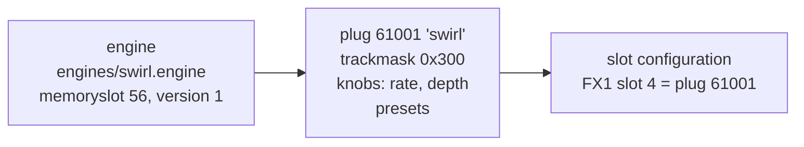
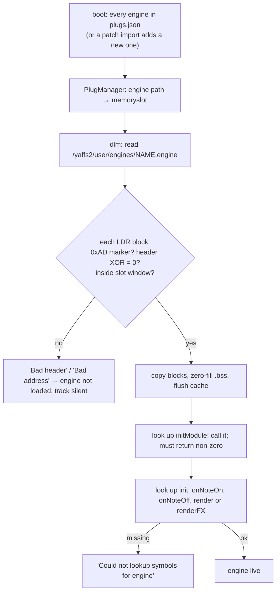

# 03 — Content and delivery

How an engine becomes a sound you can pick on a track, and how files get onto the unit.

## Three objects: engine, plug, slot



| Object | What it holds | Stored in |
|---|---|---|
| **Engine** | DSP code. Identified by its path; bound to one **memory slot**. | `engines/<name>.engine` + an entry in `plugs.json` `engines[]` |
| **Plug** | A playable sound built on an engine: id, name, engine path, sample pack, `trackmask`, `flags`, version, two knob names, presets | `plugs.json` `plugs[]` + `plugDefinitions.dat` / `plugPresets.dat` caches |
| **Slot** | Which plug sits in each of the 10 sound slots per track | `slotConfiguration.json` |

One engine can back many plugs (all drum packs share `sampleplayergain.engine`). TE plug ids run to ~153; user
plugs use **60000 and up**. [notes]

### The plug record

From TE's public catalogue (`te-dlcs.json`) [notes]:

```json
{
  "id": 98, "name": "electric", "engine": "electric.engine",
  "samples": "", "trackmask": 240, "flags": 0, "version": 0,
  "parameter_names": ["tone", "digital"],
  "presets": [
    { "slot": 0, "index": 0, "default_octave": -2, "name": "bias",
      "values": [58, 2, 0, 80, 84, 58, 8, 87, 60, 89, 137, 100, 0, 26, 178, 175, 190, 255] }
  ]
}
```

`values` are the 18 sound parameters in the order given in [02](02-sound-engine-host.md#parameters). The
meaning of `flags` is not known (seen values: 1 on dist, crush and tape; 4, 16, 20, 32 on others) — Q-08.

Full field reference: [sdk/docs/plug-format.md](../../sdk/docs/plug-format.md).

## Memory slots

An engine is linked to run at one fixed address. Its `memoryslot` number picks that address window
[code, `FUN_800fb556`]:

| Slots | Size each | Address |
|---|---|---|
| 0–7 | 50 KB | `0x81B00000 + n × 0xC800` |
| 8–57 | 10 KB | `0x81B64000 + (n − 8) × 0x2800` |
| 58+ | 5 KB | `0x81BE1000 + (n − 58) × 0x1400` |

The window holds code, constants and static data. The loader rejects any block outside it. The OS loads every
engine listed in `plugs.json` at boot, so two engines in the same slot always overwrite each other: every new
engine needs its own free slot. Allocation table and rules:
[sdk/docs/memory-slots.md](../../sdk/docs/memory-slots.md).

## How the OS loads an engine



[code: `FUN_8002ae50`, `FUN_8002ac00`, `FUN_8002b02c`, `FUN_801419a8`]. There is no signature, hash or version
gate on the engine binary.

## The import: `patch.json`

Writing a file named `settings/patch.json` makes `PlugManager::importPatch` run [code]:

```json
{
  "auto_import": [
    {
      "engine": { "path": "engines/swirl.engine", "memoryslot": 56, "version": 1 },
      "plug":   { "id": 61001, "version": 1, "name": "swirl", "engine": "engines/swirl.engine",
                  "samples": "", "trackmask": 768, "flags": 0,
                  "parameter_names": ["rate", "depth"], "presets": [] },
      "tracks": [8]
    }
  ]
}
```

For each entry it registers the engine, imports the plug (skipped if the same id with an equal or newer version
exists), and assigns it to the listed tracks. It then loads requested engines and re-exports `plugs.json`
[code, app `PlugManager::importPatch`]:

- `tracks` holds **zero-based track indices**. For each, the plug goes into the track's **first free slot** of 10
  (`assignPlugToSlot(track, -1, id)`), unless it is already on that track. If all 10 are taken it is not assigned
  ("No free slots to assign plug to"). To pick a specific slot, also upload an edited `slotConfiguration.json`.
- The device reads only `id`, `version`, `engine`, `samples`, `flags` and `presets` from a plug. `name`,
  `trackmask` and `parameter_names` are catalogue data for companion apps; **the device does not enforce
  `trackmask`**.
- Preset keys are `slot`, `index`, `name`, `defaultOctave` (camelCase, unlike TE's web catalogue) and `values`.
  `slot` is the synth track (0 bass … 3 chord; other tracks read slot 0), `index` 0–13; preset 0 is applied when a
  track switches to the plug. Presets live in RAM and are **not restored after a restart** for user plugs; a
  top-level `plugs[]` entry re-sends them without a version check, and the boot file `settings/plugs_patch.json`
  (imported at the next start, then deleted) brings them back after one restart. Details: [presets.md](../presets.md).

`tools/opz.py install` builds this file from an engine's `plug.json` and `presets.json`.

## Delivery path 1 (primary): SysEx file service in synth mode

Proven by the notes' clean-room implementation, including **custom engines** (`clean-tone.engine`,
`researchmute.engine`) [notes, proven], and by this project on 2026-10-17: our own engine installed with
`tools/opz.py` loads and runs [proven]. **Replacing an engine that is already loaded needs an OP-Z restart**: the
import updates the plug and the file, but the old code keeps running until boot [proven].

- Envelope: `F0 00 20 76 01 <msg-id> <7-bit packed payload> F7` over USB MIDI or BLE MIDI.
- Session: host advertises a server (`$51`); OP-Z answers (`$34`); host sends `$52` with sync-active 0, then the
  OP-Z pulls file `2` (`syncjob.json`, the manifest) and every listed file in **200-byte zlib parts**
  (`$35` request / `$53` data / `$33` progress, 127 = done).
- File ids: `0` = `slotConfiguration.json`, `1` = `plugs.json`, `2` = `syncjob.json`, otherwise
  `crc32(lowercase(path))`.
- The OP-Z requests a listed file unless the file already at `/yaffs2/user/<path>` has the listed CRC (computed
  from flash at request time; no stored CRCs, any path; a CRC of 0 is always requested). It stages each download in
  `inbox/<path>` and copies it in place only after its CRC matches. **Paths must be one folder deep**: the staging
  folder is made with a single `mkdir`, so `a/b/x` is dropped without an error unless `inbox/a/` already exists (the
  sync still reports complete) [code,
  device `FUN_8012bb00`, `FUN_80129454`, `FUN_80127a24`; Q-49, [samples.md §6](../samples.md#the-sync-job-q-49)].
- Writing `settings/patch.json` triggers import; writing a
  project path triggers project reload.

**An engine install is one sync job:** `engines/<name>.engine` + `settings/patch.json` (+ optionally an updated
`settings/slotConfiguration.json`).

**Removal:** a manifest entry `{"operation":"remove","plugId":61001}` deletes the plug and its sample, but **leaves
the engine file and its engine definition** behind. No normal-mode file delete is known. [notes, proven]
Consequence: re-installing a fixed build of an engine should overwrite the same path (the file service replaces
files whose CRC differs), and orphan engines accumulate until cleaned.

**Reading back:** the file service only serves a whitelist (the two settings files and a few virtual ids). Engine
files and samples cannot be pulled. Keep every installed binary on the host.

## Delivery path 2 (unproven): content mode

The content-mode importer filters `wav|aif|aiff|engine` and has format strings `%s%d.engine`, `%d.engine` and a
`json|dat` filter next to the `samplepacks` folder logic. That suggests engines can also be imported from the
content disk, probably named by plug id inside a sample-pack folder. Untested — Q-10. Also note: content
operations have been seen deleting staged engine files [notes].

## Delivery path 3 (avoid): firmware update ZIP

The updater extracts any ZIP into `/yaffs2/` and also honours `/yaffs2/firmware_auto.zip` at boot [notes]. It can
place engines, but it runs in update mode next to a root console that can brick the unit. Use only for recovery.

## The companion app

TE's app downloads plugs and engines from TE's catalogue and pushes them with the same file service. Our tool
does the same thing for our own engines. While our tool holds the file session, the official app must be closed:
two clients fighting over StateSync breaks both [notes].

Continue with [04 — Hidden and unreleased](04-hidden-and-unreleased.md).
