# Audio routing: where our effects can live (Q-19, Q-20, Q-13)

OS 1.2.45, offline only: `opz.ldr` (Blackfin, device) and the desktop app's `SnakePlugin` (arm64, has symbols) read
with Ghidra and objdump. Nothing was run on the OP-Z. Device addresses are 1.2.45; app addresses are `SnakePlugin`
offsets. Where only the app was read, the claim is labelled [code, app]; the device's mix function has the same
shape (same call order, buffers and parameter offsets checked below), so app details are a strong guide, not proof.

## Summary

- **One mix function does everything**, once per 64-frame block: `Synth::render` (app `0x52ce4`), device
  `FUN_801184c0`, called from the audio callback `0x8002325c`. Order: the eight instrument tracks → drum and synth
  buses → external input → **tape** → **FX1** → **FX2** → **master** → master filter → mixer compressor → master
  drive → volume [code, device: the four `renderFX` calls at `0x80119536`, `0x801196ee`, `0x801197f2`,
  `0x801198b0`; app the same].
- **FX1, FX2 and tape are send/return buses.** Each gets one summed stereo input, renders into a separate output
  buffer, and the OS then runs that FX track's filter (params 8/9) and a DC blocker and adds the result to the main
  mix. The OS applies **no pan or level** to an FX return: the engine does (TE's `crush` uses pan as dry/wet), and
  the `gain` argument is the mixer level × mute of that FX track. There is **no insert routing**: an "insert" effect
  is a send at 100 % with the FX track's dry level at 0, which removes the dry signal (flag `0x01` only chooses that
  dry level when an old project is upgraded; [host-tables-flags.md](host-tables-flags.md#the-bits)).
- **Master is an in-place effect slot on the whole mix**, and only the *chorus* is a plug. `renderFX` on master
  gets `in` = the main mix buffer, **`out` = NULL** and `gain` = `0x7fffffff`, and must write its result back into
  `in` [code, device `0x80119880`–`0x801198b0`: the out argument is a literal 0; app `FxManager::render(11, …,
  mainMix, 0, …)`, and TE's master `chorus` (plug 39) writes into its input]. Drive, filter and the compressor are
  OS code after the plug, so they stay whatever plug is there. Master P2 is read by the OS as the drive amount.
- **Q-20: a slot-map entry can put another plug on master, and the OS would run it.** The plug on a track is chosen
  by *track + black key* through the same handler for every track (no master exception), from the slot map's ten
  slots per track; master only shows one choice because its slot map has one entry (39) [code, app
  `TrackContext::onNotePressed` `0x38db8`; device `0x80125c50`]. **But every effect of ours writes to `out`, so on
  master it would write to address 0, take a CPU exception and reboot** — and because the plug choice is stored in
  the project, probably at every start in that project ([crash-recovery.md](crash-recovery.md#2-crash-a-few-seconds-after-every-start-an-effect-or-a-plug-the-boot-project-selects)).
  An engine needs a master mode (`out == NULL` → process `in` in place) before it can go there.
- **Q-19: notes on master.** Live keys and *sequenced* master steps reach a master plug's `onNoteOn` only in part:
  sequenced steps are played as notes only when master's note style (`params[17]`) is in its upper two thirds
  (manual: "free"); in the bottom third (manual: "latch") they only drive key changes [code, app
  `Sequencer::playNotes` `0x49e8c`]. Every master note also runs the key/chord logic that transposes the marked
  tracks.
- **Tape takes a user plug more easily than master.** Same selection path; `renderFX` on tape has the normal
  separate `in`/`out` buffers and a 2 MB pool, so an FX1-style engine runs there unchanged [code, device
  `0x80119536`]. Tape is fed by the tracks marked for tape at full level, can duck those tracks' dry sound
  (`sequencerSetValue` key 1), and returns to the main mix and to FX1/FX2.
- **External input (Q-13 detail):** mic/line/USB comes in as the module track (13): its own filter, LFO, pan, level
  and FX1/FX2 sends (fixed 40 % / 80 % in mic mode), plus tape if marked. It is **summed into the same FX input
  buffers** as the instrument sends, after its pan. An effect cannot tell the mic from the instruments in one
  buffer; see §6 for vocoder and side-chain designs that work anyway.

## 1. The graph

```mermaid
flowchart LR
  subgraph INST["instrument tracks 1–8 (per block)"]
    E["engine render → track buffer"] --> TF["OS track filter p8/p9 + DC block"]
    TF --> G["× mixer level (Synth +0x50c8/+0x5108)"]
  end
  G -->|"dry × (1−(1−dry₁)s₁)(1−(1−dry₂)s₂)(1−duck·tape?) × mute"| BUS["drum bus 1–4 / synth bus 5–8<br/>× group level"]
  BUS --> SC["sum + soft clip → main mix"]
  G -->|"× s₁ (s₁² for plug 34 or flag 0x20)"| FX1IN["FX1 in<br/>dev 0x11901604"]
  G -->|"× s₂ × (1−(1−dry₁)s₁)"| FX2IN["FX2 in<br/>dev 0x11901804"]
  G -->|"× 1 if marked for tape"| TIN["tape in<br/>dev 0x11901c04"]

  subgraph INP["external input = module track 13"]
    SEL["selector: mic / headset / line module / USB"] --> IF["filter p8/p9 + DC block → pan"]
  end
  IF -->|dry × level| SC
  IF -->|"× send₁ (mic mode 0.4)"| FX1IN
  IF -->|"× send₂ (mic mode 0.8)"| FX2IN
  IF -->|if marked for tape| TIN

  TIN --> TAPE["tape renderFX (tapetwo, plug 38)<br/>call 0x80119536, out dev 0x11901e04"]
  TAPE --> TTF["tape filter + DC"]
  TTF -->|"× (1 − tape s₂)"| SC
  TTF -->|"× tape s₁"| FX1IN
  TTF -->|"× tape s₂"| FX2IN

  FX1IN --> FX1["FX1 renderFX<br/>call 0x801196ee, out dev 0x11901a04"] --> F1F["FX1 filter + DC"] --> MM["main mix"]
  FX2IN --> FX2["FX2 renderFX<br/>call 0x801197f2, out dev 0x11901a04"] --> F2F["FX2 filter + DC"] --> MM
  SC --> MM
  MM --> MST["master renderFX IN PLACE (chorus, plug 39)<br/>call 0x801198b0, out = NULL, gain 0x7fffffff"]
  MST --> MF["master filter p8/p9 (0x801198e4) + DC (0x801198fe)"]
  MF --> BNC["bounce tap (0x8011990e)"]
  BNC --> CMP["mixer compressor ('punch')"]
  CMP --> DRV["drive: soft clip, amount = master P2"]
  DRV --> VOL["× volume → codec"]
```

Notation: `s₁`, `s₂` are a track's FX1/FX2 send (`params[6]`, `[7]`), `dry₁`, `dry₂` the FX tracks' dry level
(their `params[12]`), `duck` the tape ducker. All gains are smoothed per block (1/64 one-pole or a per-sample
ramp).

### Instrument tracks [code, app `Synth::render` `0x52ce4`]

Per track, in order: the engine's voices render into one stereo buffer (`InstrumentManager::render` `0x3be60`), the
OS track filter runs unless the plug has flag `0x04` (`trackFilterProcess` `0x51e3c`), then a DC blocker
(`trackFilterDcBlock` `0x42354`). The result `x`, scaled by the drum or synth group level and the track's mixer level
(`Synth::setMasterGain` `0x54c7c`), goes to:

| Destination | Gain | Notes |
|---|---|---|
| drum bus (tracks 1–4) or synth bus (5–8) | `(1 − (1−dry₁)·s₁)·(1 − (1−dry₂)·s₂)·(1 − duck·t)·(1 − m)·mute` | `t` = 1 if the track is marked for tape, `m` the module send; `mute` (`setMasterMute` `0x54cb4`) only here, so a muted track still feeds FX and tape (manual p.34) |
| FX1 input | `s₁·(1 − duck·t)·(1 − m)` | `s₁²` when FX1's plug is 34 (`delay`) or has flag `0x20` |
| FX2 input | `s₂·(1 − (1−dry₁)·s₁)·(1 − duck·t)·(1 − m)` | FX2 gets what FX1's crossfade left; FX1's output never reaches FX2 |
| tape input | `t·(1 − m)` | full level, not a send amount |
| module output | `m` | the module/I-O track's per-track send, when a module is fitted |

The two buses are summed and soft-clipped (`y = x + (x − x³)/2`) into the main mix. **Where the OS applies an
instrument track's pan was not found**: not in this loop, not in `Voice::renderVoice` (`0x70dd0`) or the DC
blocker. So whether pan comes before or after the sends is open (Q-29). The FX dry level and the `1 − dry` form are
the same in the device ([host-tables-flags.md](host-tables-flags.md#the-bits)). `Synth::setFXDucker(8|9, …)` is
overwritten every block by `1 − dry` (`Synth +0x6c5c`/`+0x6c60`), so only the tape ducker (`+0x6c64`) can be set
from outside.

### FX tracks: what `renderFX` gets [code, device; app the same]

FX records: `Synth + 0x45d0`, `0xe0` bytes per FX track (`track − 8`): `+0` init, `+4` renderFX, `+8` onNoteOn,
`+0xc` onNoteOff, `+0x10` state (≤ 204 B), `+0xd8` pitch bend, `+0xdc` plug id. `FUN_8012ce7a` calls renderFX when
the plug id is not 0; `FUN_8012ced0` switches the plug (init with interrupts masked, pool
`0x8112B21C + table[0x8156f21c]`).

| Track | Call | `params` | `in` | `out` | `gain` | After |
|---|---|---|---|---|---|---|
| tape (10) | `0x80119536` | track params, no LFO (`0x11900904 + 10·0x48`) | tape bus `0x11901c04` | `0x11901e04` | mixer level × mute | filter, DC; → main × (1 − tape s₂), → FX1 in × tape s₁, → FX2 in × tape s₂ (`0x801195be`–`0x8011966a`) |
| FX1 (8) | `0x801196ee` | LFO-modulated copy `0x0800b8ac` | `0x11901604` | `0x11901a04` | mixer level × mute | filter, DC, → main |
| FX2 (9) | `0x801197f2` | LFO-modulated copy `0x0800b8ac` | `0x11901804` | `0x11901a04` | mixer level × mute | filter, DC, → main |
| master (11) | `0x801198b0` | track params, no LFO (`0x11900c1c`) | **the main mix** | **NULL** | `0x7fffffff` | filter (`0x801198e4`, params 8/9 at `0x11900c3c`), DC, bounce, compressor, drive |

The buffers `0x119016xx`–`0x119020xx` are in L1 data memory. All four FX are rendered in this order in every block,
so tape's output reaches FX1/FX2 in the same block, and FX1 has finished before FX2 starts.

### Master chain [code, app `0x52ce4` tail; device from `0x801198b0`]

1. **Plug** in place: TE's `chorus` (plug 39, 16 KB request = the whole master pool). It reads only P1
   (app `Chorus::renderFX` `0x6180`).
2. **OS master filter** on master `params[8]`/`[9]`, DC blocker into `0x11902004`.
3. **Bounce tap** (`bounceAudio`; device `FUN_80120d58`): recordings take the signal here, before compressor and drive
   [inferred from the order].
4. **Mixer compressor** (`masterCompressor` app `0x3503c`, device `FUN_11a01254`): RMS window, auto threshold,
   release from a tempo-indexed table (the four `getBPM` calls, device `FUN_8010822c`).
5. **Drive**: `y = g·x`, `out = (1−d)·y + d·(1.5y − 0.5y³)` with `d` = master P2 of the second parameter set
   (device `0x119010a0` = `0x11900904 + 0x480 + 11·0x48 + 4`; app `Synth +0x6264`). So **master P2 is the OS's
   drive**, not the plug's (manual: P1 chorus, P2 drive).
6. Preview of the external input, then the volume (`Synth +0x6860`).

## 2. How a track's plug is chosen (Q-20)

- **Slot map**: `PlugManager` keeps 16 tracks × 10 slots (`getPlugFromSlot` app `0x44bb8`: `+0x48 + track·0x28 +
  slot·4`; device `FUN_800fb508`: `+0x24 + …`, same stride). `assignPlugToSlot` (app `0x456c4`, called by
  `importPatch` for each entry of a plug's `tracks`) has **no track restriction**, and the device never reads
  `trackmask` ([plug-format.md](../sdk/docs/plug-format.md)). Today's map: track 10 = {38 tapetwo}, track 11 = {39 chorus},
  each in slot 1 only.
- **Selection**: holding *track* switches to `TrackContext` on every track (app `Sequencer::updateActiveContext`
  `0x49c70`; the same handler sets a track's length with track + shift + value key, which the manual documents for
  master, p.45). A black key there → `getPlugFromSlot(activeTrack, slot)` → if not 0, `selectPlug` (app `0x39014`;
  device `0x80125c50` → `FUN_80125684` → `FUN_80045880`), which stores the plug id in the project's track data and,
  for tracks 8–11, calls the synth's note-on with note 255 (device `FUN_80117f4c` → `FUN_8012ced0`): the new
  effect's `init` runs and it renders from the next block. If the slot is empty, instrument tracks start the
  user-sample flow and tracks 8–15 do nothing — which is what the user saw on master [code; the observation matches].
  `FUN_80107e20` (device) re-selects the plugs of tracks 8–11 the same way from the project's track data.
- **Hidden plug-id entry** [code, app `0x38db8`; device `0x80125d72`–`0x80125dde`]: with a second held button
  (sequencer byte `+0x29`, button id 16 in `updateActiveState`) and shift, three key presses type a plug id as
  digits and select it on the active track, bypassing the slot map. Which button that is was not identified (Q-31).

So `opz.py install … --track master` (or `assign`) would make our plug selectable with master + black key 2, and
the OS would run it — with `out = NULL`.

## 3. Master: can our effects run there? (Q-19, Q-20)

**As built, no.** Every engine of ours writes `out`; on master that is address 0, the DCPLB has no page there, so
the first block raises a CPU exception and the OP-Z reboots ([crash-safety.md](crash-safety.md#1-what-the-os-does-on-a-fault)).
The plug id is saved in the project, so the same project would select it again after the restart.

**With a master mode, yes** [code; not tested]. What an engine must do on master:

| Issue | What the OS does | What the engine must do |
|---|---|---|
| Output | `out = NULL`, `in` = main mix | `fract32 *dst = out ? out : (fract32 *)in;` and read each frame before writing it |
| Where am I | `init(state, track, 0, mem, scratch)` gets `track` = 11 | keep `track` in state; switch modes on it |
| Memory | master pool 16 KB (`0x8112B21C + 0x440000`) | `memRequest` ≤ 16 KB (glue asks 0, swirl 8 KB) |
| P2 | is also the OS drive amount | use P1 only, or accept that P2 also drives |
| Pan/level | master `params[10]`/`[11]` exist but no page shows them (manual: no LFO/send pages on master) | ignore them on master (glue would read pan as dry/wet: possibly fully dry) |
| `gain` | `0x7fffffff` | nothing (the mixer volume comes after) |
| LFO | master params are not LFO-modulated | — |
| Notes | see below | read notes, but expect them only in "free" style |
| CPU | runs on the full mix once per block | same budget as an FX (≤ 600 cycles/sample guidance) |

What the user loses: **only TE's chorus**, and only in projects where our plug is selected; drive, filter,
compressor and transposition stay. Master + black key 1 brings the chorus back.

**Notes on master (Q-19)** [code, app]:

- *Sequenced* steps: `Sequencer::playNotes` (`0x49e8c`) skips track 11 unless master's note-style byte
  (`Sequencer +0x3461a7` = current parameter 17 of track 11; layout from `setCurrentParameter` `0x4dd9c`) × 3 > 255,
  i.e. `params[17]` ≥ 86. Then `triggerNote` (`0x4b218`) → `playNote` → `Synth::noteOn(11, plug, …)` →
  `FxManager::noteOn` → `onNoteOn`, followed by `magicChordUpdate`. Which manual style (latch/free) is ≥ 86 is
  inferred: free, since latch "holds notes to the end of the bar" without micro timing, which matches skipping
  the step-by-step note path.
- *Live* keys: `Sequencer::noteOn` (`0x4ce9c`) offers the key to the active context first; if it does not take
  it, `playNote` → the plug's `onNoteOn`, then `magicChordUpdate`. Whether the default context takes master keys was
  not traced.
- Either way the note also changes the song's key/chord for the tracks marked on master (`PatternContainer::
  getMasterSend`, bit mask at pattern data `+0x538a`). Un-mark every track (shift + track on master) before using
  notes as control input.
- Not the same thing: **`MasterEffects` is the punch-in engine**, not the master track. Punch-in keys (shift + keys
  on tracks 1–8, or keys on the perform track) are converted to perform-track notes (`convertToMasterEffect`
  `0x4cbf4` writes track 12) and become note, step-order and parameter overrides (`MasterEffects::modifyNote`,
  `replaceStepIndex`, `overrideParameters`; `MasterEcho`) [code, app names; inferred meaning]. They change what the
  tracks play and send; they never process audio buffers.

### Hardware check H-R1: a plug on master (not run)

Only with an engine that has the master mode above. Proposed `opz_test_master` (plug id: next free 609xx; not
written): passes audio through in place; P1 = 4 Hz tremolo depth (audible proof it runs); a note-on adds a short
1 kHz blip (proof notes arrive); trackmask `0xC00`. Offline first: an opzsim mode that calls `renderFX` with
`out = NULL`, `gain = 0x7fffffff`, track 11, and `opz_crashcheck` on it (both are follow-ups).

1. Backup: `tools/opz.py backup` (settings, slot map). In content mode, copy `projects/` to the Mac
   ([crash-recovery.md](crash-recovery.md)).
2. On the OP-Z, switch to an **empty project** that is not the one it starts in (SAFETY rule 7).
3. `opz.py install engines/opz_test_master --track master --dry-run`; expect track 11 = {39 slot 1, ours slot 2}.
   Then without `--dry-run`. No restart needed for a brand-new engine.
4. On master: hold track, black key 2. Expect the slot to light; turn P1: tremolo. Black key 1: chorus again.
5. Shift + track on master: un-mark all tracks. Play keys on master: blip? Sequence a few master steps; play with
   the note style at latch, then free: which gives blips.
6. Turn P2 with our plug selected: the OS drive should still act.
7. Rollback: master + black key 1; `opz.py remove <id> --unassign` (or `assign` back); switch to the start project.
   If the OP-Z reboots after selecting the plug: switch to the start project if it gets that far; otherwise content
   mode, replace the test project from the backup or delete it ([crash-recovery.md §2](crash-recovery.md#2-crash-a-few-seconds-after-every-start-an-effect-or-a-plug-the-boot-project-selects)).

## 4. Tape: can a user plug replace `tapetwo`?

**Yes, by the same path, and it is the safer target** [code; not tested]. Tape is track 10, `renderFX` with a
normal separate `out` (`0x11901e04`), `gain` = mixer level × mute, plain (un-LFO'd) params, a **2 MB** pool (as
FX1), the OS filter on params 8/9 after it. Any of our FX1 effects would run there unchanged (`echo`, `clouds`).
Selecting it: `--track tape`, then tape + black key 2; tape + black key 1 for TE's tape again.

What makes tape special:

- **Input** = the tracks marked for tape, each at full level (pattern data `+0x5388`, `PatternContainer::setTapeSend`
  `0x3d244`, copied to `Synth +0x6848` by `setTargetParameters` `0x52820`; the module track's bit 13 adds the
  external input). Marked with shift + track on tape (`setTrackSend` `0x6fab0`, case tape).
- **Output** goes to the main mix × (1 − tape FX2 send) and to FX1/FX2 by tape's own sends.
- **Ducker** (`sequencerSetValue` key 1 → `Synth::setFXDucker(10, v)` → `Synth +0x6c64`): scales the dry *and* send
  signal of every tape-marked track by `1 − v`. `tapetwo` uses it to mute the live tracks while it plays a loop
  back (`TapeTwoGetDucker`, app `0xa948`), so a replacement can do "replace" rather than "add".
- **Key 0** (`sequencerSetValue` 0) is `Sequencer::setTapeFreeze` (app `0x4f354`, byte `+0x2d`); `tapetwo` writes
  `!playing` there every block. No reader in the app; device readers not traced (Q-32).
- Notes on tape: white keys = loop start, black keys = loop length (manual p.43); `playNote` gives tape notes a
  fixed note style and `FxManager::noteOff` re-sends a still-held note (ABI §3). Keys 2/3 store the FX timing.
- `tapetwo` has flag `0x01` (an old-project upgrade gives it dry level 0; tape ignores params[12] in the mix).

**Worth pursuing?** Yes, for effects that want "the last few bars of selected tracks": beat repeat/stutter (X-04),
varispeed/reverse tapes (X-18), a looper, a granular freezer on chosen tracks. The cost for the user is losing TE's
tape tricks in projects where our plug is selected. Hardware check **H-R2**: as H-R1 steps 1–4 and 7 with `echo` (or
`opz_test_passthrough`) on tape: mark two tracks for tape, select our plug on tape + black key 2, hear it, switch
back with black key 1.

## 5. External input (Q-13 details)

[code, app `Synth::render`, `getInputSelector` `0x4e3b8`, `updateInputSelector` `0x4b75c`]

- Sources: up to four inputs mixed by the global selector bits (mic, headset, line module, USB; `g_globalInputSelector`),
  ramped per block. They become **the module track (13)**: its LFO, its filter (params 8/9, skipped while
  monitoring), DC blocker, then its pan.
- Sends: FX1 = module `params[6]`, FX2 = `params[7]`; while sequencer bytes `+0x58` and `+0x27` are both set (the
  mic mode [inferred]) the sends are fixed by two mode bits (`Sequencer +0x5c`): FX1 0.4, FX2 0.8 — the manual's
  mic mode picks FX1, FX2, both or none (p.55). Tape if module bit 13 is marked. The dry path
  uses the same `1 − (1−dry)·send` crossfade as a track and the module track's mixer level.
- **What an effect sees**: one stereo `in` = Σ track sends + input sends + tape send. The mic is mixed in after its
  own pan, so a hard-panned mic is in one channel only. Nothing marks which part is the mic.

## 6. Consequences for effect design

- **Bus effects (X-13 `glue`, X-14 `width`) without master**: send every track to FX2 at 100 % with FX2's dry level 0:
  all instrument tracks and the input then pass only through FX2 (FX1's return and, unless its FX2 send is up,
  tape's do not). That is the closest to a master insert today.
- **Side-chain across FX1 → FX2** [idea, from the code facts]: one engine selected on both FX1 and FX2 runs as two
  instances with separate states but **shared static data** (one engine image per slot), FX1 always first. FX1 can
  analyse what is sent to it (a kick for ducking, a mic for a vocoder) into a static, and FX2 apply it to what is
  sent there in the same block. `init`'s `track` (8 or 9) tells each instance its role. Needs a hardware check that
  both instances really share the image (expected from the loader: one load per engine path).
- **Vocoder (X-17)**: (a) modulator = the mic sent to FX1 only (mic mode FX1, every track's FX1 send 0), carrier =
  oscillators/noise inside the engine played by notes on FX1; (b) FX1 = analysis of the mic, FX2 = synthesis on a
  synth track sent to FX2 (the side-chain above); (c) stereo split: mic panned hard left, carrier track panned hard
  right, one FX — only if instrument pan is applied before the sends (Q-29).
- **Master effects** need the master mode (§3) and H-R1; until then keep `trackmask` without `0x800`, and treat
  `opz.py --track master` as unsafe for every existing engine (it only warns about the trackmask).

## 7. Open after this

Q-29 instrument pan vs sends, Q-30 = H-R1 (master), Q-31 the plug-id entry button, Q-32 tape freeze reader, H-R2
(tape). See [OPEN_QUESTIONS.md](OPEN_QUESTIONS.md).
