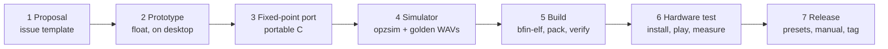

# Development workflow

How a new synth or effect goes from idea to an OP-Z.



## Planned repository layout

```text
engines/
  swirl/
    plug.json            # slot, plug id, trackmask, knob names
    presets.json         # 18-byte presets
    swirl.c              # the engine: portable C against opz_engine.h
    swirl_dsp.h          # DSP kernels (fixed point)
    tests/*.scn          # notes + parameter sweeps for golden renders (sim/README.md)
    tests/golden/*.wav.sha256  # + *.spectrum.json
    README.md            # one-page manual: knobs, presets, CPU cost, credits
sdk/
  include/opz_engine.h
  include/opz_dsp.h      # shared fixed-point kernels: PolyBLEP, SVF, one-pole, interpolation, noise
  ld/engine.ld.in        # linker script template, filled per slot
sim/                     # opzsim host for macOS
tools/
  opz_pack.py            # ELF → .engine
  opz_verify.py          # loader checks + export map
  opz.py                 # the CLI (build, install, remove, backup, restore)
docs/
```

## 1. Proposal

Open an issue with .github/ISSUE_TEMPLATE/engine-proposal.md.
It must state: track type, what P1/P2 do, what filter/resonance do, slot class, memory request, estimated
CPU, inspiration and licence of any reference code.

## 2. Prototype in floating point

Any tool is fine (Python/NumPy, C++, Max). The point is to decide what it sounds like and how the two knobs
behave. Keep a reference render.

## 3. Fixed-point port

- Q31 for signals and parameters, Q15 where 16-bit is enough (the Blackfin does dual 16-bit MACs).
- Phase accumulators as `uint32_t` wrapping counters — the host's `pitch` is already in that form [inferred].
- Precompute per-block (64 frames) anything that depends only on parameters: coefficients, increments.
- No division in the per-sample loop; use reciprocal tables or Newton steps per block.
- Saturate every addition that can overflow.
- Prefer the host's tables (`g_sine`, `k_lp_table`, `rFilterCoeffs`) over your own.

## 4. Simulator

`opzsim` runs the engine compiled for macOS with the OP-Z's call pattern, renders the scenarios, and checks:

- golden WAV hashes (exact) and a spectral tolerance (for refactors);
- state size ≤ 280 B (voice) or 200 B (FX), static size within the slot class;
- no NaN-equivalents: DC offset, clipping count, silence where sound is expected;
- worst-case parameter sweeps (all knobs 0 and 255, fast LFO on P1/P2).

## 5. Build

```bash
python3 tools/opz_build.py engines/swirl
```

It reads the slot from `plug.json`, fills [`sdk/ld/engine.ld.in`](../ld/engine.ld.in) with that slot's
window, compiles every `.c` with `bfin-elf-gcc -mcpu=bf592-none -O2 -ffreestanding -fno-builtin …`, links with
`-nostdlib` and `libgcc`, packs with `opz_pack.py elf` and checks with `opz_verify.py`. Outputs go to
`build/bfin/<name>/`: `.elf`, `.map`, `.lst` (disassembly) and `.engine`. Each engine source ends with
`OPZ_EXPORTS_FX();` or `OPZ_EXPORTS_INSTRUMENT();`, which emits the export table on the Blackfin build only.
Toolchain install: [toolchain-setup.md](../../research/toolchain-setup.md).

### Multiplies on the Blackfin

`opz_mul_q31` / `opz_add_q31` use the Blackfin's native fractional multiply and saturating add
(`__builtin_bfin_mult_fr1x32x32`, `__builtin_bfin_add_fr1x32`) on the device build. A plain
`(int64_t)a * b >> 31` compiles to a `libgcc` `___muldi3` call, tens of cycles each: use the SDK helpers in audio
loops. The SVF's Q30 coefficient maths still uses 64-bit products — an optimisation for after P3's cycle counts.

### Size on the Blackfin

The simulator's size check measures the Mac build and **understates** the Blackfin size: `swirl` is ~2.2 KB on
arm64 but 3.9 KB of Blackfin code at `-O2`, plus ~1.2 KB for `libgcc`'s `___divdi3` as soon as the code divides
64-bit numbers. `opz_build.py` is the real check (the linker refuses to overflow the slot). To stay small: avoid
64-bit division (precompute reciprocals per block), or move the engine up a slot class rather than dropping to
`-Os` in audio code.

## 6. Hardware test

1. `opz backup`
2. `opz install engines/swirl --track fx2 --slot 5`
3. Play the test project; turn every knob through its range; sequence notes on the FX track if the engine uses them.
4. `opz log --verbose` while playing: no loader errors, no `cpu overload`.
5. Increase voices or stack instances on FX1 and FX2 to find the CPU ceiling; record it in the engine README.
6. `opz remove`, `opz restore`, confirm readback.

## 7. Release

- Version bump in `plug.json` (both the plug `version` and the engine `version` when the binary changes).
- ≥ 8 presets with names.
- README: knob map, presets, CPU cost, slot, credits and licence of any ported code.
- Tag `engine/<name>/v<version>`; attach `.engine`, `patch.json` and golden WAVs to the release.

## Definition of done for an engine

- [ ] `opz_verify` passes; slot recorded in [memory-slots.md](memory-slots.md)
- [ ] `tools/opz_crashcheck.py engines/<name> --full` reports no errors ([crash-safety.md](../../research/crash-safety.md))
- [ ] Golden tests pass in `opzsim`
- [ ] Installed, played, removed and reinstalled on hardware without errors
- [ ] CPU cost measured and documented
- [ ] Presets and manual written
- [ ] Licence of all ported code is MIT/BSD/public domain and credited
